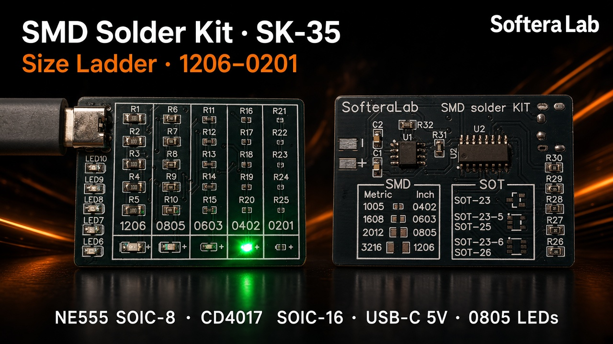
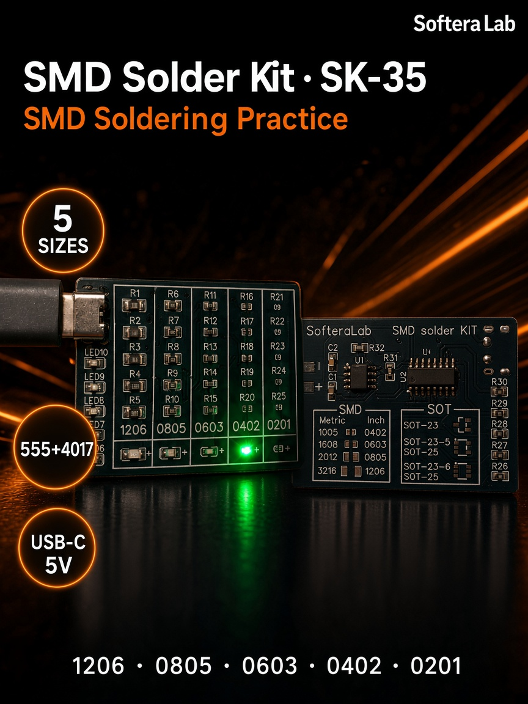
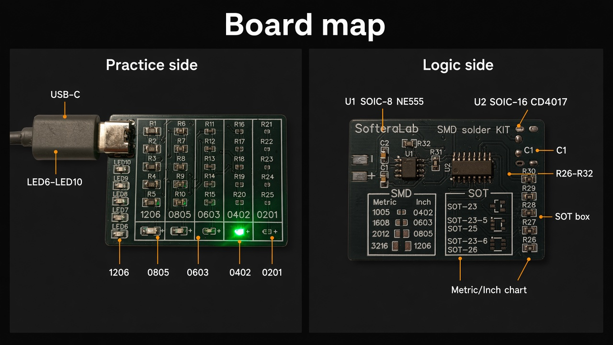
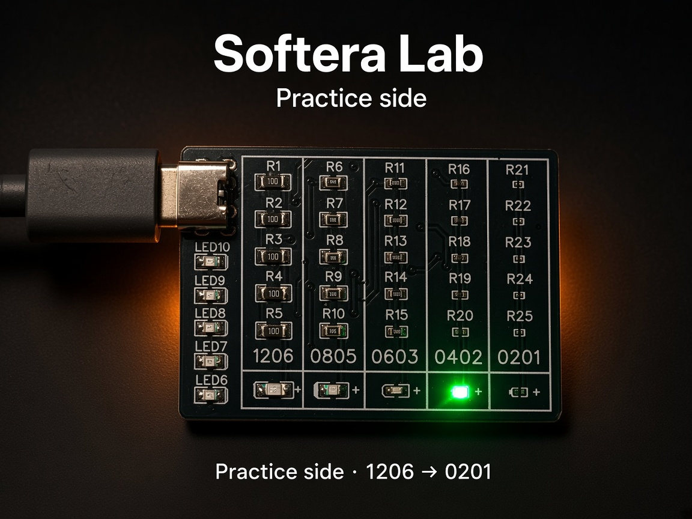
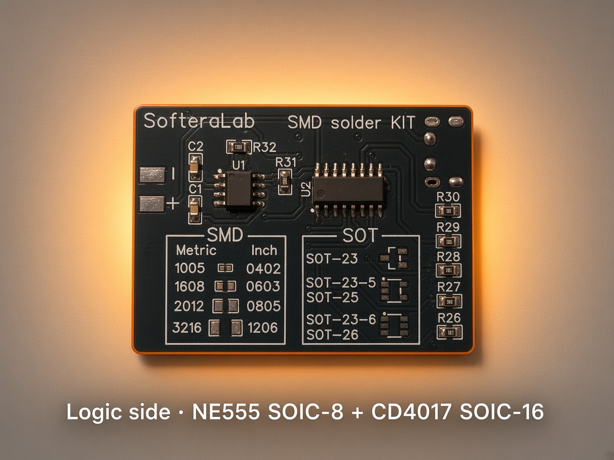
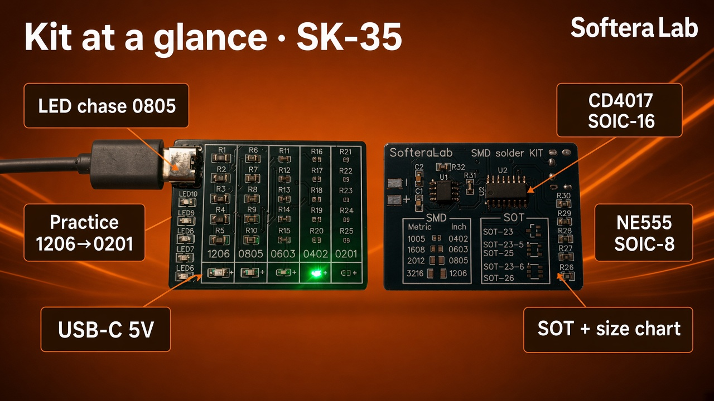
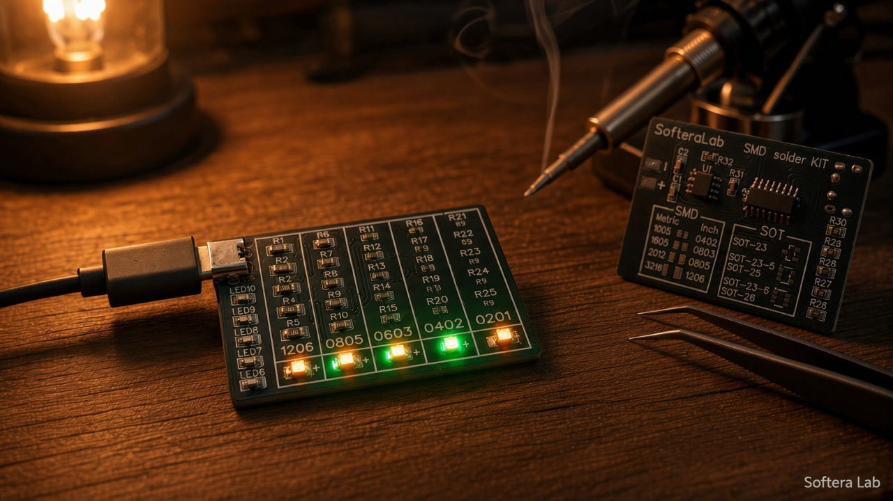
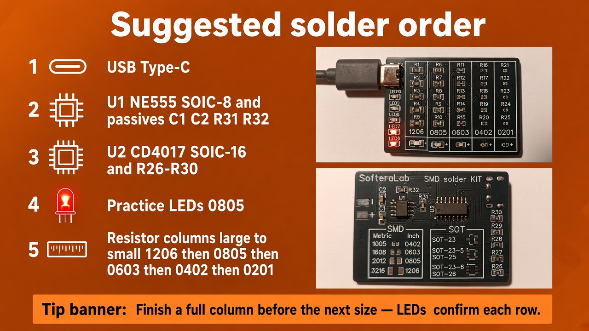
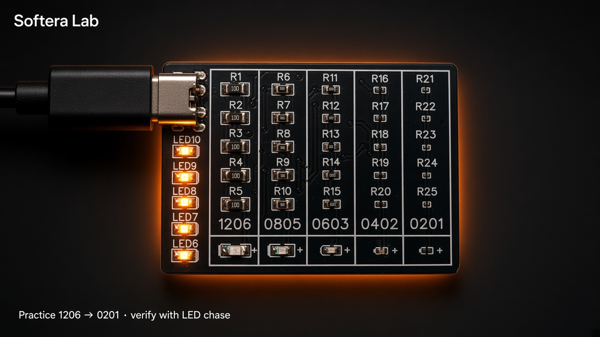

<p align="center">
  <a href="https://www.softeralab.com/">
    
  </a>
</p>

<h1 align="center">SMD Solder Kit · SK-35</h1>

<p align="center"><strong>Softera Lab soldering kit — NE555 · CD4017 · LED chase · practice 1206 → 0201 · USB-C 5 V · SK-35</strong></p>

<p align="center">
  <a href="README.uk.md"></a>
  <a href="https://www.softeralab.com/"></a>
  <a href="https://www.instagram.com/softeralab/"></a>
  <a href="https://www.youtube.com/@SofteraLab"></a>
  
</p>

<p align="center"><strong>Languages:</strong> English (this page) · <a href="README.uk.md">Українська</a></p>

<p align="center">
  
</p>

**SMD Solder Kit · SK-35** is a Softera Lab training board for surface-mount soldering. You practice five resistor package sizes — **1206, 0805, 0603, 0402, 0201** — and the board checks your work: when a full size column is soldered correctly, the **0805 LEDs** light **in turn**, confirming that row.

No microcontroller and nothing to flash. Timing comes from **NE555 (U1, SOIC-8)**; the decade counter **CD4017 (U2, SOIC-16)** steps the chase. Power is **USB Type-C, 5 V**. Logic passives (**R**, **C**) are **0805**.

The other face carries the ICs, SOT practice footprints, and a Metric/Inch size chart.

This repository is a **product page and assembly notes**. It is **not open-source hardware** — Gerbers and manufacturing files are not published.

> © Softera Lab. All rights reserved.

<p align="center">
  <br>
  <em>Practice face lit · logic face with NE555 + CD4017</em>
</p>

## How it works

1. Plug in **USB Type-C** — board runs from **5 V**  
2. **NE555** generates the clock  
3. **CD4017** advances the LED sequence  
4. Solder a **full column** of resistors for one size (**1206 → 0201**)  
5. When that column is correct, the matching LEDs join the chase  

## Board tour

<p align="center">
  
</p>

| Zone | What you get |
| --- | --- |
| **Power** | **USB Type-C** · **5 V** · pads **+ / −** on the logic face |
| **Clock** | **NE555** (**U1**, **SOIC-8**) |
| **Counter** | **CD4017** (**U2**, **SOIC-16**) |
| **Indicators** | **0805 LEDs** — chase + per-column check |
| **Practice** | Five columns: **1206 · 0805 · 0603 · 0402 · 0201** (R1–R25) |
| **Passives** | Logic **R** / **C** in **0805** |
| **Reference** | Metric/Inch chart · **SOT-23 / 25 / 26** practice pads |

### Practice side

<p align="center">
  <br>
  <em>Size ladder 1206 → 0201 · LED6–LED10 · USB-C</em>
</p>

### Logic / production side

<p align="center">
  <br>
  <em>U1 NE555 · U2 CD4017 · SOT · Metric/Inch</em>
</p>

## Inside the kit

<p align="center">
  <br>
  <em>Practice face · logic face · what’s in SK-35</em>
</p>

1. Black PCB — practice face + logic face  
2. **NE555** (**SOIC-8**) and **CD4017** (**SOIC-16**)  
3. **USB Type-C** female connector  
4. **0805** SMD LEDs for the chase / column check  
5. SMD resistors **1206 · 0805 · 0603 · 0402 · 0201**  
6. Logic **0805** SMD resistors and capacitors (**C1**, **C2**, …)  

## Specs

| Parameter | Value |
| --- | --- |
| Product | **SMD Solder Kit · SK-35** |
| Supply | **5 V** via **USB Type-C** |
| Clock | **NE555** (**U1**, **SOIC-8**) |
| Counter | **CD4017** (**U2**, **SOIC-16**) |
| LEDs | **0805** |
| Practice sizes | **1206 · 0805 · 0603 · 0402 · 0201** |
| Logic passives | **0805** |
| MCU / firmware | **None** |
| Check | LEDs chase when each size column is soldered correctly |

## Assembly

<p align="center">
  
</p>

<p align="center">
  
</p>

Suggested order:

1. **USB Type-C**  
2. **U1 NE555** + support **C1 / C2 / R31 / R32** (**0805**)  
3. **U2 CD4017** + **R26–R30**  
4. Practice **0805** LEDs (watch polarity)  
5. Resistor columns **large → small**: **1206 → 0805 → 0603 → 0402 → 0201**  
6. Plug in **5 V** — finish one full column at a time; LEDs confirm each size row  

## Social / catalog

<p align="center">
  
</p>

Catalog line:

```text
- [SMD Solder Kit SK-35](https://github.com/SofteraLab/smd-solder-kit-sk35) — NE555 + CD4017 LED chase · practice 1206–0201 · USB-C 5 V · SK35
```

## Links

- Website: [softeralab.com](https://www.softeralab.com/)  
- Course: [Basic soldering](https://www.softeralab.com/course-basic-soldering/)  
- Instagram: [@softeralab](https://www.instagram.com/softeralab/)  
- YouTube: [@SofteraLab](https://www.youtube.com/@SofteraLab)  

## License / copyright

See [COPYRIGHT.md](COPYRIGHT.md). All rights reserved. Not open-source hardware.
