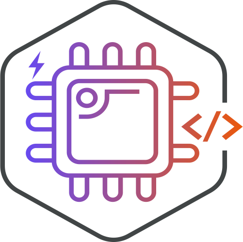
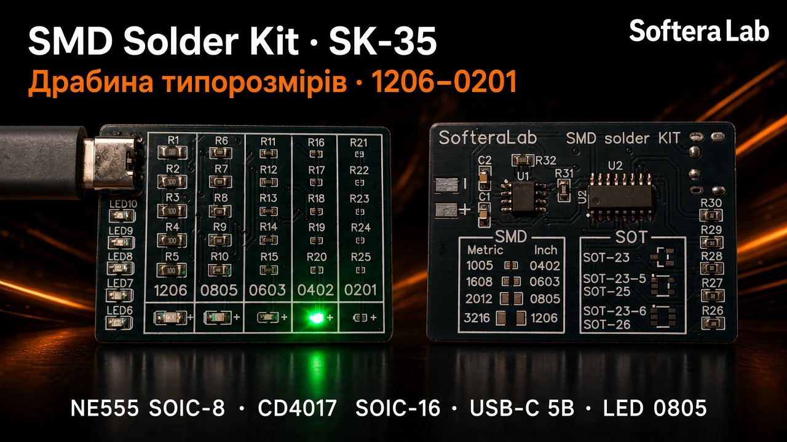
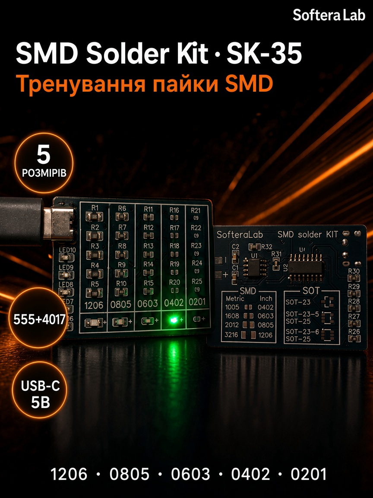
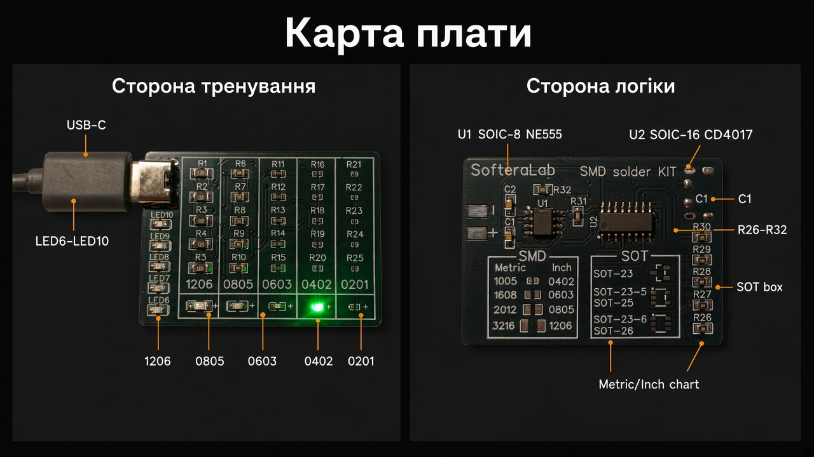
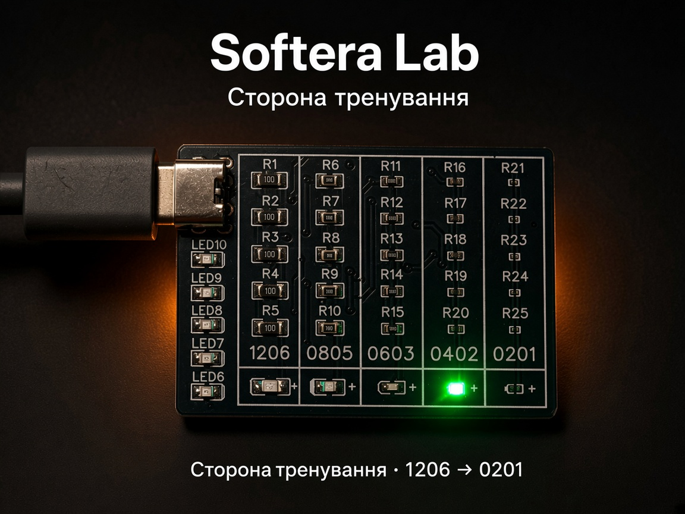
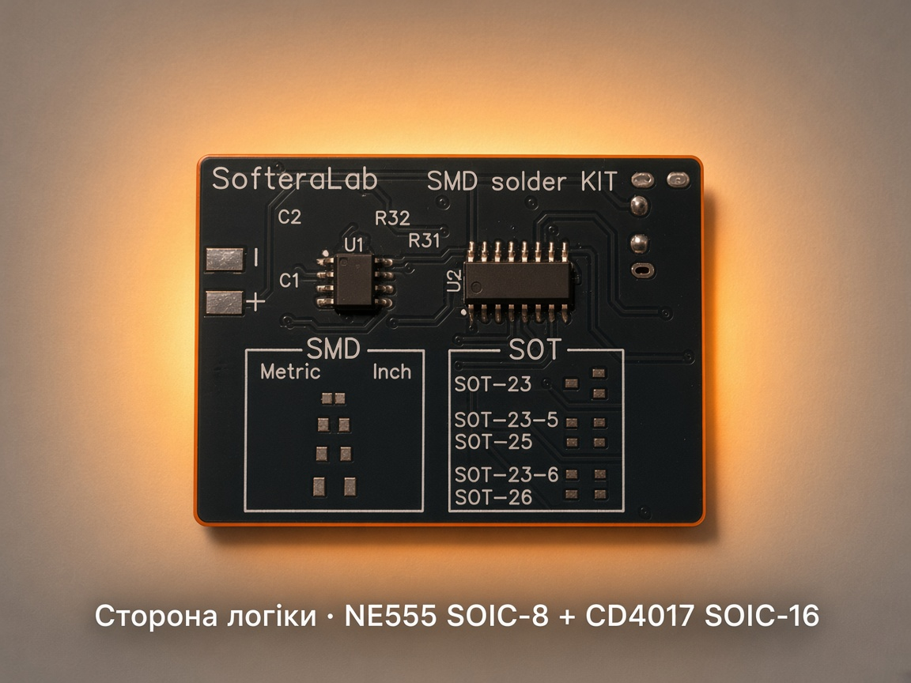
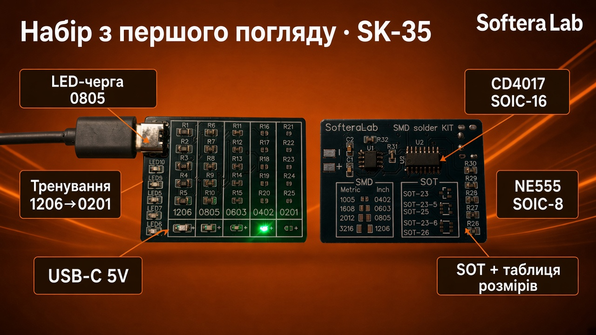
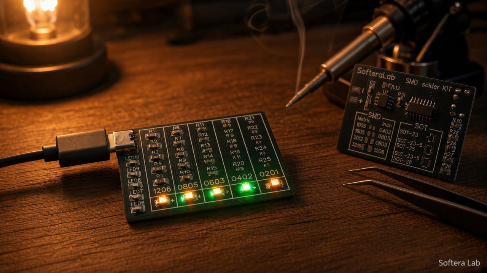
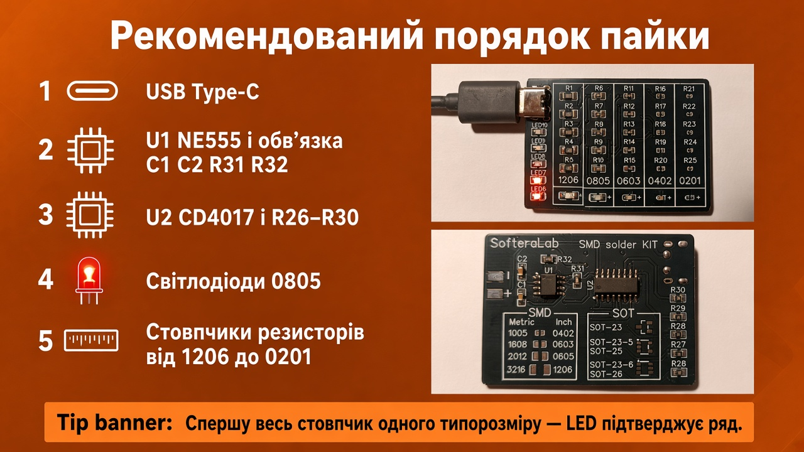
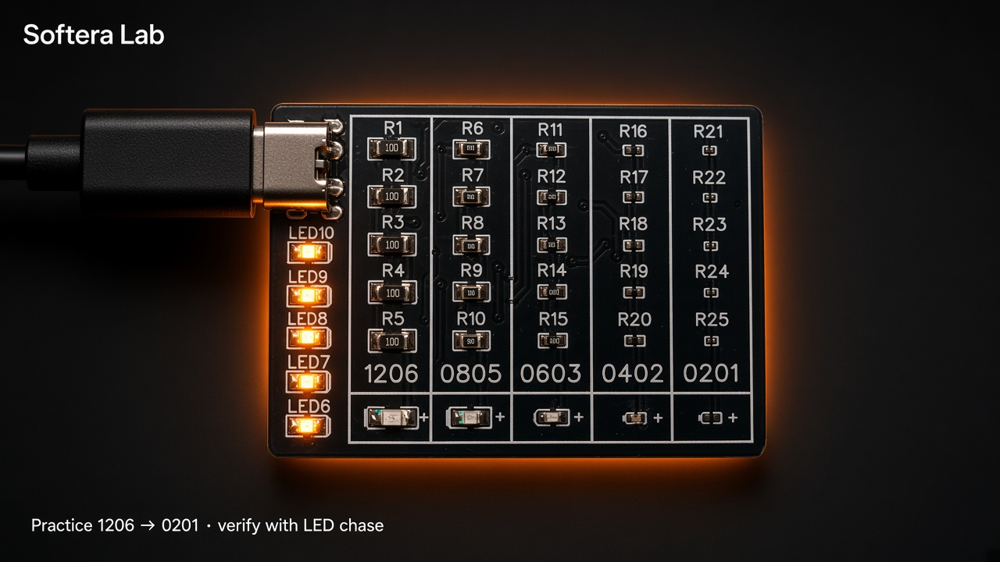

<p align="center">
  <a href="https://www.softeralab.com/">
    
  </a>
</p>

<h1 align="center">SMD Solder Kit · SK-35</h1>

<p align="center"><strong>Навчальний набір Softera Lab — NE555 · CD4017 · LED-черга · тренування 1206 → 0201 · USB-C 5 В · SK-35</strong></p>

<p align="center">
  <a href="README.md"></a>
  <a href="https://www.softeralab.com/"></a>
  <a href="https://www.instagram.com/softeralab/"></a>
  <a href="https://www.youtube.com/@SofteraLab"></a>
  
</p>

<p align="center"><strong>Мови:</strong> <a href="README.md">English</a> · Українська (ця сторінка)</p>

<p align="center">
  
</p>

**SMD Solder Kit · SK-35** — навчальна плата Softera Lab для пайки SMD. Тренуєте п’ять типорозмірів резисторів — **1206, 0805, 0603, 0402, 0201** — і плата сама перевіряє роботу: коли весь стовпчик одного типорозміру запаяно правильно, **світлодіоди 0805** вмикаються **по черзі** й показують, що цей ряд зібрано вірно.

Мікроконтролера немає, прошивати нічого. Такт дає **NE555 (U1, SOIC-8)**, кроки по LED — лічильник **CD4017 (U2, SOIC-16)**. Живлення — **USB Type-C, 5 В**. Обв’язка логіки (**R**, **C**) — **0805**.

На другому боці — мікросхеми, площадки SOT для тренування та таблиця Metric/Inch.

Цей репозиторій — **сторінка продукту й нотатки збірки**. Це **не open-source hardware**: Gerber і виробничі файли публічно не викладаються.

> © Softera Lab. All rights reserved.

<p align="center">
  <br>
  <em>Сторона тренування зі світлом · сторона логіки з NE555 + CD4017</em>
</p>

## Як працює

1. Підключіть **USB Type-C** — плата працює від **5 В**  
2. **NE555** задає такт  
3. **CD4017** крокує по світлодіодах  
4. Запаюєте **повний стовпчик** резисторів одного типорозміру (**1206 → 0201**)  
5. Якщо ряд правильний — відповідні LED приєднуються до черги  

## Огляд плати

<p align="center">
  
</p>

| Зона | Що є |
| --- | --- |
| **Живлення** | **USB Type-C** · **5 В** · площадки **+ / −** на боці логіки |
| **Такт** | **NE555** (**U1**, **SOIC-8**) |
| **Лічильник** | **CD4017** (**U2**, **SOIC-16**) |
| **Індикація** | **LED 0805** — черга + перевірка стовпчиків |
| **Тренування** | П’ять стовпчиків: **1206 · 0805 · 0603 · 0402 · 0201** (R1–R25) |
| **Обв’язка** | Логічні **R** / **C** у **0805** |
| **Довідник** | Таблиця Metric/Inch · площадки **SOT-23 / 25 / 26** |

### Сторона тренування

<p align="center">
  <br>
  <em>Драбина 1206 → 0201 · LED6–LED10 · USB-C</em>
</p>

### Сторона логіки / продакшн

<p align="center">
  <br>
  <em>U1 NE555 · U2 CD4017 · SOT · Metric/Inch</em>
</p>

## Що в наборі

<p align="center">
  <br>
  <em>Сторона тренування · сторона логіки · що входить у SK-35</em>
</p>

1. Чорна плата — сторона тренування + сторона логіки  
2. **NE555** (**SOIC-8**) і **CD4017** (**SOIC-16**)  
3. Роз’єм **USB Type-C** (female)  
4. SMD світлодіоди **0805** для черги / перевірки  
5. SMD резистори **1206 · 0805 · 0603 · 0402 · 0201**  
6. Логічні SMD резистори й конденсатори **0805** (**C1**, **C2**, …)  

## Характеристики

| Параметр | Значення |
| --- | --- |
| Продукт | **SMD Solder Kit · SK-35** |
| Живлення | **5 В** через **USB Type-C** |
| Такт | **NE555** (**U1**, **SOIC-8**) |
| Лічильник | **CD4017** (**U2**, **SOIC-16**) |
| LED | **0805** |
| Типорозміри | **1206 · 0805 · 0603 · 0402 · 0201** |
| Обв’язка | **0805** |
| МК / прошивка | **Немає** |
| Перевірка | LED по черзі, якщо стовпчик типорозміру запаяно правильно |

## Збірка

<p align="center">
  
</p>

<p align="center">
  
</p>

Рекомендований порядок:

1. **USB Type-C**  
2. **U1 NE555** + обв’язка **C1 / C2 / R31 / R32** (**0805**)  
3. **U2 CD4017** + **R26–R30**  
4. Тренувальні **LED 0805** (полярність)  
5. Стовпчики резисторів **від великих до малих**: **1206 → 0805 → 0603 → 0402 → 0201**  
6. Підключіть **5 В** — спочатку весь стовпчик одного типорозміру; LED підтверджує ряд  

## Соцмережі / каталог

<p align="center">
  
</p>

Рядок для каталогу:

```text
- [SMD Solder Kit SK-35](https://github.com/SofteraLab/smd-solder-kit-sk35) — NE555 + CD4017 LED-черга · тренування 1206–0201 · USB-C 5 В · SK35
```

## Посилання

- Сайт: [softeralab.com](https://www.softeralab.com/)  
- Курс: [Базова пайка](https://www.softeralab.com/course-basic-soldering/)  
- Instagram: [@softeralab](https://www.instagram.com/softeralab/)  
- YouTube: [@SofteraLab](https://www.youtube.com/@SofteraLab)  

## Авторське право

Див. [COPYRIGHT.md](COPYRIGHT.md). Усі права захищені. Не open-source hardware.
